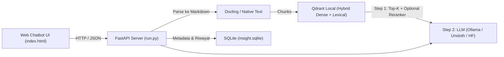

<div align="center">
  <h1>InSight</h1>
  <p><strong>Private Document RAG Workspace with Docling, Qdrant Local, SQLite, and Selectable Full/Quantized LLM Inference.</strong></p>

  [](https://www.python.org/)
  [](https://fastapi.tiangolo.com/)
  [](https://qdrant.tech/)
  [](LICENSE)
</div>

---

## Ringkasan

**InSight** adalah prototype sistem Retrieval-Augmented Generation (RAG) untuk berinteraksi dengan dokumen Anda (PDF, DOCX, PPTX, XLSX, HTML, gambar, Markdown, TXT, CSV, JSON, dan kode) tanpa mengirim dokumen ke API LLM pihak ketiga.

### Model Privasi (Penting Diketahui)
InSight mendukung dua cara menjalankan backend:
1. **Mode Lokal 100% Offline (Laptop / Server Pribadi):** FastAPI, Docling, Qdrant Local, SQLite, dan **Ollama** berjalan penuh di mesin Anda. Dokumen tidak pernah keluar dari perangkat.
2. **Mode Google Colab (GPU Cloud Sementara):** Cocok jika perangkat lokal tidak memiliki GPU. Dokumen diproses langsung di runtime sesi Colab milik Anda (tidak dikirim ke OpenAI/Anthropic/API eksternal), dan dapat dilindungi kata sandi (`INSIGHT_PASSWORD`) serta dihapus saat sesi berakhir. *(Catatan: secara teknis file tetap melintasi server Google Colab karena runtime berada di cloud Google.)*

---

## Arsitektur



### Fitur Utama Prototype
- **Docling Document Parsing:** Mengubah PDF, DOCX, PPTX, XLSX, HTML, dan gambar menjadi Markdown terstruktur sebelum diindeks.
- **Qdrant Local Mode:** Penyimpanan vektor langsung di folder lokal tanpa container Docker atau server eksternal, lengkap dengan penghapusan vektor otomatis saat dokumen dihapus dari daftar.
- **Penyaringan 2-Tahap Ringan:** Pencarian hybrid (dense vector + lexical overlap) dan opsi Cross-Encoder Reranker (~22M hingga 278M parameter) agar konteks yang dikirim ke LLM lebih ringkas dan hemat VRAM.
- **Opsi Presisi Model (`4bit` / `8bit` / `full`):** Memudahkan penyesuaian dengan paket GPU Colab (T4 15GB, L4 24GB, hingga A100) atau PC lokal.
- **Riwayat & Daftar Dokumen di SQLite:** Ringan, portabel dalam satu file `.sqlite`, dan mendukung reset riwayat per sesi.
- **Proteksi Kata Sandi Opsional:** Mengamankan akses endpoint saat server dijalankan di balik tunnel Colab.

---

## Tutorial Penggunaan

### Opsi A: Menjalankan Secara Lokal (100% Offline)

#### 1. Clone dan siapkan virtual environment
```bash
git clone https://github.com/Cahyo-Wisanggeni/InSight.git
cd InSight
python -m venv .venv
```

Aktifkan environment:
- **Windows (PowerShell):**
  ```powershell
  .venv\Scripts\Activate.ps1
  ```
- **Linux / macOS:**
  ```bash
  source .venv/bin/activate
  ```

#### 2. Install dependensi
```bash
pip install -r requirements.txt
```

#### 3. Pilih mode LLM lokal
- **Mode Preview Cepat (tanpa download model LLM dulu):** langsung jalankan server untuk menguji upload, parsing, pencarian Qdrant, dan riwayat SQLite.
  ```bash
  python run.py
  ```
- **Mode LLM Offline Penuh via Ollama:** pastikan [Ollama](https://ollama.com/) sudah terpasang dan model sudah ditarik (misalnya `ollama pull qwen2.5:7b`), lalu jalankan:
  - Windows PowerShell:
    ```powershell
    $env:INSIGHT_LLM_BACKEND="ollama"
    $env:INSIGHT_LLM_MODEL="qwen2.5:7b"
    python run.py
    ```
  - Linux / macOS:
    ```bash
    INSIGHT_LLM_BACKEND=ollama INSIGHT_LLM_MODEL=qwen2.5:7b python run.py
    ```

#### 4. Buka aplikasi
Buka browser ke `http://127.0.0.1:8000`, unggah dokumen dari panel kiri, lalu ketik pertanyaan dan tekan `Enter`.

---

### Opsi B: Menjalankan di Google Colab (GPU + Tunnel)

1. Buka notebook [`notebooks/InSight_Colab.ipynb`](notebooks/InSight_Colab.ipynb) di Google Colab dan pilih Runtime dengan GPU (misalnya T4, L4, atau A100).
2. Jalankan sel instalasi untuk clone repo dan memasang `requirements.txt` + `requirements-colab.txt`.
3. Pada sel konfigurasi, sesuaikan variabel berikut dengan kapasitas GPU Anda:
   - **Colab Free (T4 15GB):** `INSIGHT_PRECISION="4bit"` dan `INSIGHT_LLM_BACKEND="unsloth"`
   - **Colab Pro (L4 24GB):** `INSIGHT_PRECISION="8bit"`
   - **Colab Pro+ (A100 40GB+):** `INSIGHT_PRECISION="full"`
   - Isi `INSIGHT_PASSWORD` untuk mencegah akses asing pada URL tunnel publik.
4. Jalankan sel terakhir untuk menyalakan FastAPI dan tunnel Cloudflare, lalu buka URL `https://....trycloudflare.com` yang tercetak di output sel.

---

## Konfigurasi Environment (`.env`)

Salin `.env.example` jika ingin mengatur konfigurasi secara persisten:

| Variabel | Default | Keterangan |
|---|---|---|
| `INSIGHT_HOST` | `127.0.0.1` | Host server FastAPI (`0.0.0.0` untuk Colab) |
| `INSIGHT_PORT` | `8000` | Port server |
| `INSIGHT_DATA_DIR` | `./data` | Direktori penyimpanan SQLite dan Qdrant lokal |
| `INSIGHT_PASSWORD` | `""` (kosong) | Kata sandi sesi opsional untuk login |
| `INSIGHT_LLM_BACKEND` | `retrieval_only` | Pilihan: `retrieval_only`, `ollama`, `unsloth`, `hf` |
| `INSIGHT_LLM_MODEL` | `unsloth/Qwen2.5-7B-Instruct-bnb-4bit` | Nama model Hugging Face / Unsloth / Ollama |
| `INSIGHT_PRECISION` | `4bit` | Presisi model: `4bit`, `8bit`, atau `full` |
| `INSIGHT_EMBED_MODEL` | `BAAI/bge-small-en-v1.5` | Model embedding Step 1 |
| `INSIGHT_USE_RERANKER` | `false` | Aktifkan Cross-Encoder reranker (`true` / `false`) |
| `INSIGHT_RERANK_MODEL` | `cross-encoder/ms-marco-MiniLM-L-6-v2` | Model reranker ringan Step 1 |

---

## Ringkasan API

FastAPI juga menyediakan dokumentasi interaktif otomatis di `http://127.0.0.1:8000/docs`.

| Method & Path | Fungsi |
|---|---|
| `GET /health` | Cek status server, backend LLM, presisi, dan jumlah dokumen |
| `POST /auth/login` | Tukar `INSIGHT_PASSWORD` menjadi token sesi `X-InSight-Token` |
| `POST /documents/upload` | Unggah dan indeks dokumen ke Qdrant + SQLite |
| `GET /documents` | Ambil daftar dokumen terindeks |
| `DELETE /documents/{doc_id}` | Hapus dokumen dari SQLite dan vektornya dari Qdrant |
| `POST /chat` | Ajukan pertanyaan RAG dan simpan ke riwayat SQLite |
| `GET /history` | Ambil riwayat chat per sesi |
| `DELETE /history` | Bersihkan riwayat chat per sesi |

---

## Pengujian

Jalankan test suite dengan:

```bash
pytest -v
```

---

## Lisensi

Dirilis di bawah lisensi [MIT](LICENSE).
