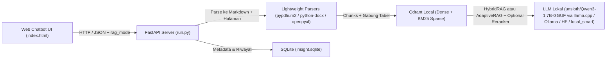

<div align="center">
  <h1>InSight</h1>
  <p><strong>Private Document RAG Workspace with Lightweight Parsers, Qdrant Local, SQLite, and Selectable Full/Quantized LLM Inference.</strong></p>

  [](https://www.python.org/)
  [](https://fastapi.tiangolo.com/)
  [](https://qdrant.tech/)
  [](LICENSE)
</div>

---

## Ringkasan

**InSight** adalah prototype sistem Retrieval-Augmented Generation (RAG) untuk berinteraksi dengan dokumen Anda (PDF, DOCX, PPTX, XLSX, HTML, Markdown, TXT, CSV, JSON, dan kode) tanpa mengirim dokumen ke API LLM pihak ketiga.

### Model Privasi (100% Lokal & Offline)
FastAPI, parser dokumen ringan (`pypdfium2`, `python-docx`, `python-pptx`, `openpyxl`, `beautifulsoup4`), Qdrant Local, SQLite, folder `resources/`, dan LLM lokal (**llama.cpp GGUF** / **Ollama** / `local_smart`) berjalan penuh di perangkat Anda. Dokumen dan pertanyaan tidak pernah keluar dari PC Anda.

---

## Arsitektur



### Fitur Utama
- **Hanya 2 Opsi Metode RAG (`HybridRAG` & `AdaptiveRAG`):**
  - **HybridRAG (`hybrid`):** Menggabungkan pencarian vektor dense + sparse BM25/lexical (`0.70 dense + 0.30 sparse`) dengan evaluasi relevansi dan *query rewriting* otomatis 1x jika hasil awal kurang relevan.
  - **AdaptiveRAG (`adaptive`):** Menggunakan `QueryAnalyzer` untuk menganalisis kompleksitas (`simple`, `medium`, `complex`), faktualitas, dan kebutuhan multi-sumber, lalu merutekan ke strategi `direct_llm`, `simple_vector`, `hybrid_search` (bobot dinamis `0.8/0.2` atau `0.6/0.4`), atau `comprehensive` dengan eskalasi otomatis bila relevan rendah.
- **Model Selection Dinamis (0.6B / 0.8B / 1.7B):** Pengguna dapat memilih model LLM langsung dari Web UI (dropdown di toolbar atau Pengaturan) antara `Qwen3-0.6B` (super cepat & hemat RAM), `Qwen3.5-0.8B` (seimbang & cepat), atau `Qwen3-1.7B` (analisis mendalam), serta dukungan model Ollama lokal jika aktif.
- **Lightweight Document Parsing & Sitasi Halaman:** Mengubah PDF, DOCX, PPTX, XLSX, dan HTML menjadi Markdown terstruktur secara cepat tanpa beban PyTorch/OCR, melacak `page_label` per chunk, serta menggabungkan tabel Markdown yang terpecah lintas halaman.
- **Qdrant Local Mode + Transparansi Embedder:** Penyimpanan vektor langsung di folder lokal tanpa Docker, dengan status fallback `HashingEmbedder` yang diekspos di `/health` dan banner UI (serta opsi `INSIGHT_STRICT_EMBEDDER=true`).
- **Folder `resources/` Terpusat:** Seluruh unduhan model & cache (`HF_HOME`, `FASTEMBED_CACHE_PATH`, `OLLAMA_MODELS`, `TORCH_HOME`, `XDG_CACHE_HOME`) diarahkan ke `INSIGHT_RESOURCES_DIR` (default `./resources`) dan dapat dipantau lewat `GET /resources` serta modal Settings.
- **Opsi Presisi Model (`4bit` / `8bit` / `full`):** Memudahkan penyesuaian dengan spesifikasi RAM/GPU lokal.
- **Riwayat & Daftar Dokumen di SQLite:** Ringan, portabel dalam satu file `.sqlite`, dengan penghapusan vektor Qdrant otomatis saat dokumen dihapus.
- **Proteksi Kata Sandi Opsional:** Mengamankan akses endpoint lewat `INSIGHT_PASSWORD` dengan rate-limiting login (`HTTP 429`) dan masa berlaku token (`INSIGHT_TOKEN_TTL_SECONDS`).

---

## Tutorial Penggunaan

### Opsi A: Menjalankan Secara Lokal (100% Offline)

#### 1. Clone dan siapkan virtual environment
```bash
git clone https://github.com/Cahyo-Wisanggeni/InSight.git
cd InSight
python -m venv .venv
```

Aktifkan environment:
- **Windows (PowerShell):**
  ```powershell
  .venv\Scripts\Activate.ps1
  ```
- **Linux / macOS:**
  ```bash
  source .venv/bin/activate
  ```

#### 2. Install dependensi
```bash
pip install -r requirements.txt
```

#### 3. Jalankan aplikasi (otomatis buka UI & mati saat UI ditutup)
- **Cara termudah di Windows:** double-click **`InSight.bat`** (atau jalankan `python launch.py`). Server menyala di belakang layar, UI terbuka otomatis, dan saat jendela UI ditutup server ikut berhenti bersih.
- **Mode Preview Cepat (lewat terminal manual, server tetap nyala):**
  ```bash
  python run.py
  ```
- **Mode LLM Offline Penuh via Ollama:** pastikan [Ollama](https://ollama.com/) sudah terpasang dan model sudah ditarik (misalnya `ollama pull qwen2.5:7b`), lalu jalankan:
  - Windows PowerShell:
    ```powershell
    $env:INSIGHT_LLM_BACKEND="ollama"
    $env:INSIGHT_LLM_MODEL="qwen2.5:7b"
    python run.py
    ```
  - Linux / macOS:
    ```bash
    INSIGHT_LLM_BACKEND=ollama INSIGHT_LLM_MODEL=qwen2.5:7b python run.py
    ```

#### 4. Buka aplikasi
Buka browser ke `http://127.0.0.1:8000`, unggah dokumen dari panel kiri, lalu ketik pertanyaan dan tekan `Enter`.

---

## Konfigurasi Environment (`.env`)

Salin `.env.example` jika ingin mengatur konfigurasi secara persisten:

| Variabel | Default | Keterangan |
|---|---|---|
| `INSIGHT_HOST` | `127.0.0.1` | Host server FastAPI |
| `INSIGHT_PORT` | `8000` | Port server |
| `INSIGHT_DATA_DIR` | `./data` | Direktori penyimpanan SQLite dan Qdrant lokal |
| `INSIGHT_RESOURCES_DIR` | `./resources` | Direktori terpusat untuk semua model/cache terunduh |
| `INSIGHT_PASSWORD` | `""` (kosong) | Kata sandi sesi opsional untuk login |
| `INSIGHT_TOKEN_TTL_SECONDS` | `43200` | Masa berlaku token sesi login dalam detik (default 12 jam) |
| `INSIGHT_LOGIN_MAX_ATTEMPTS` | `5` | Batas percobaan login gagal per IP sebelum diblokir `HTTP 429` |
| `INSIGHT_LOGIN_WINDOW_SECONDS` | `60` | Jendela waktu rate-limit login dalam detik |
| `INSIGHT_LLM_BACKEND` | `auto` (`llamacpp` di `.env.example`) | Pilihan: `auto`, `llamacpp`, `local_smart`, `retrieval_only`, `ollama`, `unsloth`, `hf` |
| `INSIGHT_LLM_MODEL` | `unsloth/Qwen3-1.7B-GGUF` | Repo/model LLM lokal (GGUF `resources/gguf`, Ollama, atau Hugging Face) |
| `INSIGHT_GGUF_FILE` | `Qwen3-1.7B-UD-Q4_K_XL.gguf` | Nama file `.gguf` pilihan dari repo `unsloth/Qwen3-1.7B-GGUF` |
| `INSIGHT_PRECISION` | `4bit` | Presisi model: `4bit`, `8bit`, atau `full` |
| `INSIGHT_RAG_MODE` | `hybrid` | Pilihan metode RAG (hanya 2 opsi): `hybrid` (`HybridRAG`) atau `adaptive` (`AdaptiveRAG`) |
| `INSIGHT_EMBED_MODEL` | `sentence-transformers/paraphrase-multilingual-MiniLM-L12-v2` | Model embedding multibahasa (Indonesia/Inggris) Step 1 |
| `INSIGHT_STRICT_EMBEDDER` | `false` | Set `true` agar server menolak startup jika hanya `HashingEmbedder` fallback yang tersedia |
| `INSIGHT_MAX_UPLOAD_MB` | `50` | Batas maksimal ukuran file unggahan dalam MB |
| `INSIGHT_USE_RERANKER` | `false` | Aktifkan Cross-Encoder reranker (`true` / `false`) |
| `INSIGHT_RERANK_MODEL` | `cross-encoder/ms-marco-MiniLM-L-6-v2` | Model reranker ringan Step 1 |
| `INSIGHT_AUTO_SHUTDOWN` | `0` (`1` di `launch.py`) | Matikan server otomatis saat tab/jendela UI ditutup |

---

## Ringkasan API

FastAPI juga menyediakan dokumentasi interaktif otomatis di `http://127.0.0.1:8000/docs`.

| Method & Path | Fungsi |
|---|---|
| `GET /health` | Cek status server, backend LLM, metode RAG aktif (`rag_mode` & `available_rag_modes`), status embedder, folder `resources`, dan jumlah dokumen |
| `GET /resources` | Pantau daftar file dan ukuran cache/model terunduh di `INSIGHT_RESOURCES_DIR` |
| `POST /auth/login` | Tukar `INSIGHT_PASSWORD` menjadi token sesi `X-InSight-Token` (rate-limited + TTL) |
| `GET /models` | Ambil daftar model LLM lokal dan preset yang tersedia beserta status aktif/unduhan |
| `POST /models/select` | Beralih model LLM aktif secara instan (`qwen3-0.6b`, `qwen3.5-0.8b`, `qwen3-1.7b`, atau Ollama) |
| `POST /documents/upload` | Unggah dan indeks dokumen ke Qdrant + SQLite |
| `GET /documents` | Ambil daftar dokumen terindeks |
| `DELETE /documents/{doc_id}` | Hapus dokumen dari SQLite dan vektornya dari Qdrant |
| `POST /chat` | Ajukan pertanyaan dengan `rag_mode` (`hybrid` atau `adaptive`) dan simpan ke riwayat SQLite |
| `POST /chat/stream` | Ajukan pertanyaan dengan streaming token Server-Sent Events (SSE) langsung ke UI |
| `GET /history` | Ambil riwayat chat per sesi |
| `DELETE /history` | Bersihkan riwayat chat per sesi |
| `GET /sessions` | Ambil daftar sesi percakapan tersimpan |

---

## Pengujian

Jalankan test suite dengan:

```bash
pytest -v
```

---

## Lisensi

Dirilis di bawah lisensi [MIT](LICENSE).
