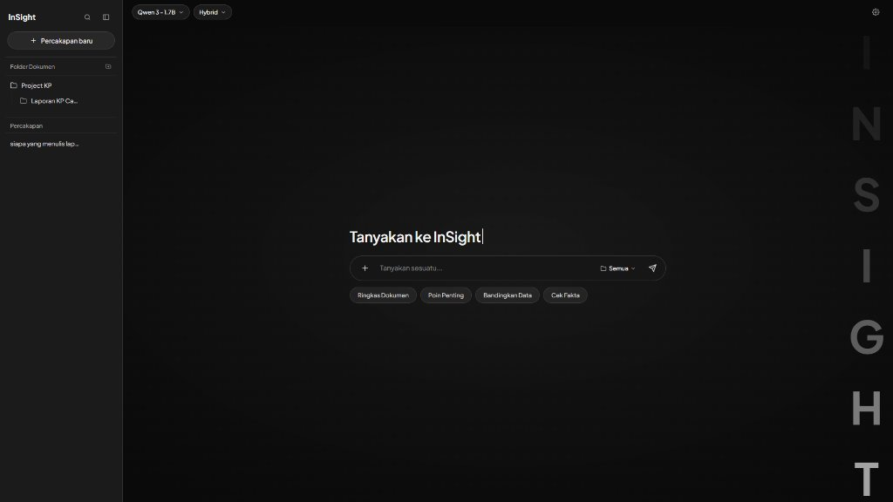
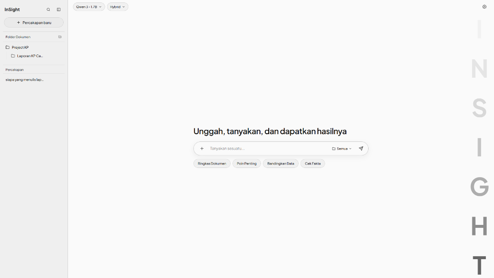
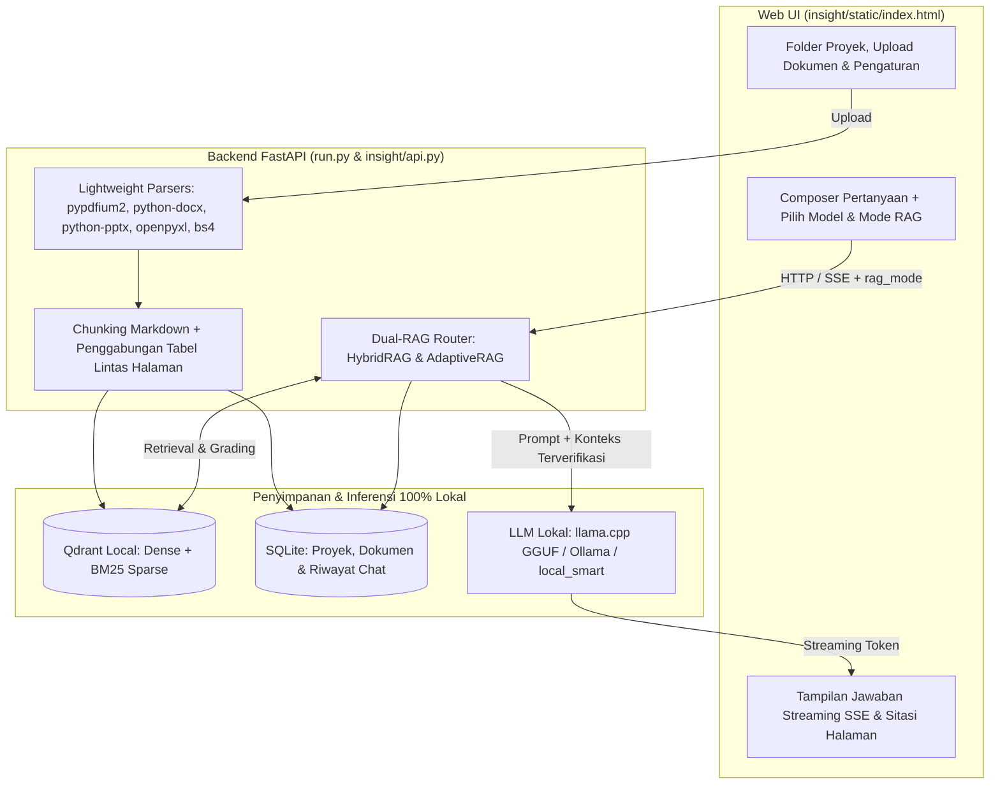

<div align="center">

  <h1><sub><picture><source media="(prefers-color-scheme: dark)" srcset="insight/static/logo-dark.svg" /><source media="(prefers-color-scheme: light)" srcset="insight/static/logo.svg" /></picture></sub> InSight</h1>

  <p>
    <strong>Workspace <em>Retrieval-Augmented Generation</em> (RAG) Dokumen Privat 100% Lokal &amp; Offline</strong>
  </p>

  <p>
    Ajukan pertanyaan langsung ke koleksi dokumen Anda (PDF, DOCX, PPTX, XLSX, HTML, Markdown, TXT, CSV, JSON, YAML, LaTeX, dan Python) secara privat di perangkat sendiri menggunakan parser ringan, Qdrant Local, SQLite, dan LLM lokal tanpa mengirim data ke API pihak ketiga.
  </p>

  <p>
    <a href="https://github.com/Cahyo-Wisanggeni/InSight/releases/tag/v0.1.0"></a>
    <a href="https://www.python.org/"></a>
    <a href="https://fastapi.tiangolo.com/"></a>
    <a href="https://qdrant.tech/"></a>
    <a href="https://www.sqlite.org/"></a>
    <a href="https://github.com/ggml-org/llama.cpp"></a>
    <a href="LICENSE"></a>
  </p>

  <p>
    <a href="#pratinjau-aplikasi">Pratinjau</a> &middot;
    <a href="#keunggulan--fitur-utama">Fitur Utama</a> &middot;
    <a href="#rincian-mode-rag--pilihan-model">Mode RAG &amp; Model</a> &middot;
    <a href="#panduan-memulai-cepat">Panduan Memulai</a> &middot;
    <a href="#ringkasan-api">API</a>
  </p>

</div>

<br/>

<div align="center">
  <a href="https://github.com/Cahyo-Wisanggeni/InSight/releases/download/v0.1.0/InSight-Demo.mp4">
    
  </a>
  <p>
    <sub>Sorotan demo otomatis — <a href="https://github.com/Cahyo-Wisanggeni/InSight/releases/download/v0.1.0/InSight-Demo.mp4">tonton video demo lengkap HD (5 menit 07 detik)</a></sub>
  </p>
</div>

---

## Daftar Isi

- [Keunggulan & Fitur Utama](#keunggulan--fitur-utama)
- [Pratinjau Aplikasi](#pratinjau-aplikasi)
- [Rincian Mode RAG & Pilihan Model](#rincian-mode-rag--pilihan-model)
- [Panduan Memulai Cepat](#panduan-memulai-cepat)
- [Konfigurasi Environment (.env)](#konfigurasi-environment-env)
- [Arsitektur Sistem](#arsitektur-sistem)
- [Ringkasan API](#ringkasan-api)
- [Struktur Repositori](#struktur-repositori)
- [Pengujian](#pengujian)
- [Lisensi](#lisensi)

---

## Keunggulan & Fitur Utama

**Privasi 100% Lokal & Offline**<br>
FastAPI, parser dokumen ringan, Qdrant Local, SQLite, direktori `resources/`, dan LLM lokal (`llama.cpp` GGUF / Ollama / `local_smart`) berjalan sepenuhnya di PC Anda. Dokumen dan pertanyaan tidak pernah keluar dari perangkat.

**Dual RAG Ketat: HybridRAG & AdaptiveRAG**<br>
Memilih secara langsung antara `HybridRAG` (vektor dense + BM25 sparse + *query rewriting* otomatis) atau `AdaptiveRAG` (analisis kompleksitas pertanyaan untuk merutekan strategi pencarian terbaik).

**Pilihan Model LLM Dinamis dari UI**<br>
Beralih cepat antara `Qwen3-0.6B` (super cepat & hemat RAM), `Qwen3.5-0.8B` (seimbang), `Qwen3-1.7B` (analisis mendalam), atau model Ollama lokal tanpa perlu restart server.

**Parsing Ringan & Sitasi Halaman Akurat**<br>
Mengonversi PDF (`pypdfium2`), DOCX, PPTX, XLSX, dan HTML ke Markdown terstruktur tanpa beban PyTorch/OCR, melacak `page_label` per chunk, serta menggabungkan tabel Markdown yang terpecah lintas halaman.

**Folder Proyek & Pencarian Terfokus**<br>
Kelompokkan dokumen ke dalam folder proyek (mis. `Project KP`), lalu arahkan pencarian ke proyek tertentu atau seluruh dokumen terindeks langsung dari kolom *composer*.

**Streaming Jawaban Real-Time & Tema Adaptif**<br>
Mendukung *token streaming* via Server-Sent Events (SSE), mode gelap/terang, riwayat percakapan SQLite, serta penghapusan vektor Qdrant otomatis saat dokumen dihapus.

**Folder `resources/` Terpusat & Proteksi Opsional**<br>
Seluruh cache model (`HF_HOME`, `FASTEMBED_CACHE_PATH`, `OLLAMA_MODELS`, `TORCH_HOME`) terpusat di `./resources` yang dapat dipantau via UI, ditambah proteksi kata sandi opsional (`INSIGHT_PASSWORD`) dengan *rate-limiting* dan TTL token.

---

## Pratinjau Aplikasi

Antarmuka Web UI minimalis dengan dukungan **Mode Gelap** dan **Mode Terang**, manajemen folder proyek, pemilih model & mode RAG di toolbar atas, serta pengalaman tanya-jawab dokumen yang bersih:

| Mode Gelap | Mode Terang |
| :---: | :---: |
|  |  |

---

## Rincian Mode RAG & Pilihan Model

1. **HybridRAG (`hybrid`)**:
   - Menggabungkan pencarian vektor *dense* dan *sparse* BM25/leksikal (`0.70 dense + 0.30 sparse`) dengan evaluasi relevansi dan *query rewriting* otomatis 1x bila hasil awal kurang relevan.
2. **AdaptiveRAG (`adaptive`)**:
   - Menggunakan `QueryAnalyzer` untuk menilai kompleksitas (`simple`, `medium`, `complex`), faktualitas, dan kebutuhan multi-sumber, lalu merutekan otomatis ke `direct_llm`, `simple_vector`, `hybrid_search` (`0.8/0.2` atau `0.6/0.4`), atau `comprehensive` dengan eskalasi otomatis.
3. **Model Selection Dinamis**:
   - Tersedia langsung dari dropdown toolbar UI maupun modal Pengaturan, termasuk opsi presisi (`4bit` / `8bit` / `full`) untuk menyesuaikan spesifikasi RAM/GPU lokal.

---

## Panduan Memulai Cepat

### 1. Prasyarat Sistem
- **Python 3.10+** (teruji pada Python 3.10 hingga 3.13).
- Koneksi internet hanya diperlukan saat mengunduh paket dan file model GGUF pertama kali (setelah itu dapat berjalan 100% offline).

### 2. Kloning Repositori & Instalasi Dependensi

```bash
git clone https://github.com/Cahyo-Wisanggeni/InSight.git
cd InSight

# Membuat dan mengaktifkan virtual environment
python -m venv .venv

# Windows (PowerShell)
.venv\Scripts\Activate.ps1

# Linux / macOS
source .venv/bin/activate

# Pasang seluruh paket dependensi
pip install -r requirements.txt
```

### 3. Menjalankan Aplikasi

#### Pada Windows (Sekali Klik):
- Klik dua kali berkas **`InSight.bat`** (atau jalankan `python launch.py`). Server berjalan otomatis di latar belakang, UI langsung terbuka di browser, dan server berhenti bersih saat jendela UI ditutup.

#### Melalui Terminal (Mode Manual):
```bash
python run.py
```

#### Menggunakan Ollama Lokal (Opsional):
Pastikan [Ollama](https://ollama.com/) aktif dan model sudah diunduh (mis. `ollama pull qwen2.5:7b`), lalu jalankan:
```powershell
# Windows PowerShell
$env:INSIGHT_LLM_BACKEND="ollama"
$env:INSIGHT_LLM_MODEL="qwen2.5:7b"
python run.py
```
```bash
# Linux / macOS
INSIGHT_LLM_BACKEND=ollama INSIGHT_LLM_MODEL=qwen2.5:7b python run.py
```

### 4. Buka Aplikasi
Akses `http://127.0.0.1:8000` di browser, unggah dokumen ke folder proyek di panel kiri, pilih model dan mode RAG, lalu ajukan pertanyaan Anda.

---

## Konfigurasi Environment (`.env`)

Salin `.env.example` menjadi `.env` untuk menyimpan pengaturan secara persisten. Berikut variabel utama yang paling sering disesuaikan:

| Variabel | Default | Keterangan |
|---|---|---|
| `INSIGHT_HOST` / `INSIGHT_PORT` | `127.0.0.1` / `8000` | Alamat host dan port server FastAPI |
| `INSIGHT_LLM_BACKEND` | `auto` (`llamacpp` di `.env.example`) | Pilihan: `auto`, `llamacpp`, `local_smart`, `retrieval_only`, `ollama`, `unsloth`, `hf` |
| `INSIGHT_LLM_MODEL` | `unsloth/Qwen3-1.7B-GGUF` | Repo/model LLM lokal (GGUF `resources/gguf`, Ollama, atau Hugging Face) |
| `INSIGHT_RAG_MODE` | `hybrid` | Pilihan metode RAG: `hybrid` (`HybridRAG`) atau `adaptive` (`AdaptiveRAG`) |
| `INSIGHT_PRECISION` | `4bit` | Presisi model: `4bit`, `8bit`, atau `full` |
| `INSIGHT_PASSWORD` | `""` (kosong) | Kata sandi sesi opsional untuk melindungi akses endpoint |

<details>
<summary><b>Klik untuk melihat seluruh variabel konfigurasi lanjutan</b></summary>

| Variabel | Default | Keterangan |
|---|---|---|
| `INSIGHT_DATA_DIR` | `./data` | Direktori penyimpanan SQLite dan Qdrant lokal |
| `INSIGHT_RESOURCES_DIR` | `./resources` | Direktori terpusat untuk semua model dan cache terunduh |
| `INSIGHT_GGUF_FILE` | `Qwen3-1.7B-UD-Q4_K_XL.gguf` | Nama file `.gguf` pilihan dari repo model |
| `INSIGHT_EMBED_MODEL` | `sentence-transformers/paraphrase-multilingual-MiniLM-L12-v2` | Model embedding multibahasa (Indonesia/Inggris) |
| `INSIGHT_STRICT_EMBEDDER` | `false` | Set `true` agar server menolak startup jika hanya `HashingEmbedder` fallback yang tersedia |
| `INSIGHT_USE_RERANKER` | `false` | Aktifkan Cross-Encoder reranker (`true` / `false`) |
| `INSIGHT_RERANK_MODEL` | `cross-encoder/ms-marco-MiniLM-L-6-v2` | Model reranker ringan |
| `INSIGHT_MAX_UPLOAD_MB` | `50` | Batas maksimal ukuran file unggahan (MB) |
| `INSIGHT_TOKEN_TTL_SECONDS` | `43200` | Masa berlaku token sesi login dalam detik (12 jam) |
| `INSIGHT_LOGIN_MAX_ATTEMPTS` | `5` | Batas percobaan login gagal per IP sebelum `HTTP 429` |
| `INSIGHT_LOGIN_WINDOW_SECONDS` | `60` | Jendela waktu rate-limit login (detik) |
| `INSIGHT_AUTO_SHUTDOWN` | `0` (`1` di `launch.py`) | Matikan server otomatis saat tab/jendela UI ditutup |

</details>

---

## Arsitektur Sistem



| Komponen | Spesifikasi |
|---|---|
| **Backend Web & API** | FastAPI + Uvicorn (termasuk SSE streaming di `/chat/stream`) |
| **Parser Dokumen** | `pypdfium2`, `python-docx`, `python-pptx`, `openpyxl`, `beautifulsoup4` |
| **Vector Database** | Qdrant Local Mode (`Dense` + `BM25Okapi` Sparse) tanpa Docker |
| **Database Metadata** | SQLite (`data/insight.sqlite`) untuk proyek, dokumen, dan riwayat sesi |
| **Strategi RAG** | `HybridRAG` (0.70/0.30 + rewrite) & `AdaptiveRAG` (`QueryAnalyzer` + routing) |
| **Inferensi LLM Lokal** | `llama-cpp-python` (GGUF `Qwen3-0.6B` / `3.5-0.8B` / `3-1.7B`) atau `Ollama` |
| **Keamanan Opsional** | Session token `X-InSight-Token` dengan TTL dan rate-limit login (`HTTP 429`) |

---

## Ringkasan API

FastAPI menyediakan dokumentasi interaktif otomatis (Swagger UI) di `http://127.0.0.1:8000/docs`.

<details>
<summary><b>Klik untuk melihat daftar lengkap endpoint REST &amp; SSE</b></summary>

| Method & Path | Fungsi |
|---|---|
| `GET /health` | Cek status server, backend LLM, metode RAG aktif, status embedder, folder `resources`, dan jumlah dokumen |
| `GET /resources` | Pantau daftar file dan ukuran cache/model terunduh di `INSIGHT_RESOURCES_DIR` |
| `POST /auth/login` | Tukar `INSIGHT_PASSWORD` menjadi token sesi `X-InSight-Token` (rate-limited + TTL) |
| `GET /models` | Ambil daftar model LLM lokal dan preset yang tersedia beserta status aktif/unduhan |
| `POST /models/select` | Beralih model LLM aktif secara instan (`qwen3-0.6b`, `qwen3.5-0.8b`, `qwen3-1.7b`, atau Ollama) |
| `POST /documents/upload` | Unggah dan indeks dokumen ke Qdrant + SQLite |
| `GET /documents` | Ambil daftar dokumen terindeks |
| `DELETE /documents/{doc_id}` | Hapus dokumen dari SQLite dan vektornya dari Qdrant |
| `POST /chat` | Ajukan pertanyaan dengan `rag_mode` (`hybrid` atau `adaptive`) dan simpan ke riwayat SQLite |
| `POST /chat/stream` | Ajukan pertanyaan dengan streaming token Server-Sent Events (SSE) langsung ke UI |
| `GET /history` | Ambil riwayat chat per sesi |
| `DELETE /history` | Bersihkan riwayat chat per sesi |
| `GET /sessions` | Ambil daftar sesi percakapan tersimpan |

</details>

---

## Struktur Repositori

```text
InSight/
├── .env.example
├── .gitignore
├── InSight.bat
├── LICENSE
├── README.md
├── launch.py
├── pyproject.toml
├── requirements.txt
├── run.py
├── assets/
│   ├── demo.webp
│   ├── ui_preview_dark.png
│   └── ui_preview_light.png
├── insight/
│   ├── __init__.py
│   ├── api.py
│   ├── config.py
│   ├── llm.py
│   ├── parser.py
│   ├── rag.py
│   ├── storage.py
│   ├── vectorstore.py
│   └── static/
│       ├── index.html
│       ├── logo.svg
│       └── logo-dark.svg
└── tests/
    └── test_insight.py
```

---

## Pengujian

Jalankan test suite dengan:

```bash
pytest -v
```

---

## Lisensi

Didistribusikan di bawah lisensi **[MIT License](LICENSE)**.
